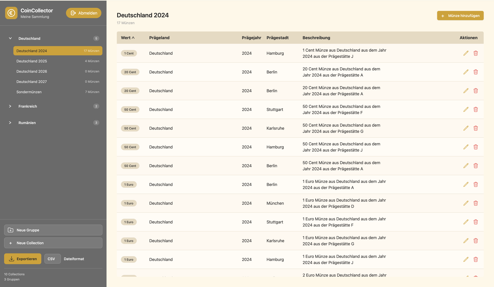
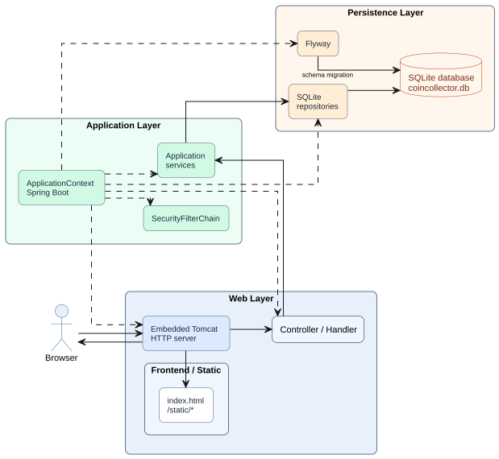

# CoinCollector

CoinCollector is a Java application for collecting and managing coins with a web-based frontend.

## Features

- Manage coin collections, groups, and individual coins
- Authentication with password protection
- Export your collection data
- Local SQLite storage

## Roadmap

Planned for upcoming releases:

- More frontend views and display options
- Import functionality
- Further improvements to collection management

## Screenshots

<p align="center">
  
</p>

## Releases

Download the latest packaged version, including the Windows installer, from the
[GitHub Releases](https://github.com/lstramke/coincollector/releases) page.

## Getting Started

### Prerequisites

- Java 21
- Maven
- Node.js and npm

### Run the application

From the `coincollector/` directory, run:

```shell
mvn spring-boot:run
```

This command installs and builds the frontend, starts the Spring Boot application,
and serves the application at [http://localhost:8080](http://localhost:8080).

## Project Structure

- `coincollector/` - Spring Boot backend
  - `src/main/java/` - Java source code
  - `src/main/resources/` - Application configuration, migrations, and static resources
  - `target/` - Maven build output
- `frontend/` - Svelte, TypeScript, and Vite frontend
  - `src/` - Frontend source code
  - `dist/` - Frontend build output
- `docs/` - Architecture, data model, and design documentation

## Architecture

<p align="center">
  
</p>

## Technology Stack

### Backend

- Java 21
- Spring Boot
- Spring Security
- SQLite with Flyway migrations
- Maven

### Frontend

- Svelte
- TypeScript
- Vite
- Tailwind CSS
- Axios

## Development

The Maven configuration automatically runs `npm install`, builds the frontend,
copies the generated files into the backend resources, and starts Spring Boot.
No separate frontend build or backend build command is required for local development.

In the long term, CoinCollector is intended to run on a server. The frontend and
backend will then be built and deployed separately, with the frontend served
independently from the backend API.
